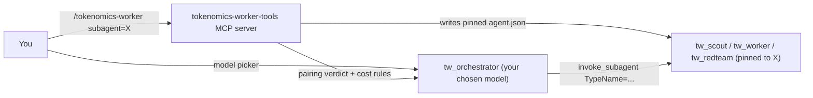
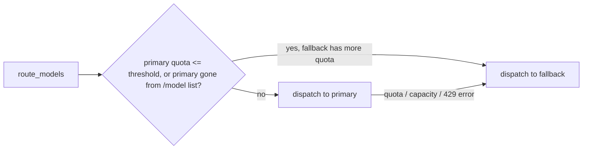

# tokenomics-worker

An orchestrator/worker plugin for the Antigravity agent IDE where **you choose
both models**. An expensive *orchestrator* keeps the judgment work
(decomposition, arbitration, review, the final answer). Cheaper, **pinned**
*subagents* do the bulk reading, typing and waiting. The plugin also checks
whether your pairing actually saves quota.

Everything is driven from chat, with the same model list the CLI's `/model`
shows. You don't edit config files or run scripts.

```text
/tokenomics-worker models
```

```text
 #  Label                      Model ID                 Quota  Reset  Current
--  -------------------------  -----------------------  -----  -----  ---------
 1  Gemini 3.8 Flash (High)    gemini-3.8-flash-high      78%  05:58  subagent
 2  Gemini 3.8 Flash (Medium)  gemini-3.8-flash-medium    78%  05:58
 3  Gemini 3.1 Pro             gemini-3.1-pro-high       100%  18:29  fallback
...
```

followed by an interactive picker for the subagent model, its fallback, the
orchestrator's fallback, and whether to keep the choice for this conversation
or save it as your default.

## Why

Models are often billed in different units against different budgets:

| Billing | You pay for | Implication |
| :------ | :---------- | :---------- |
| **Token-metered** | Every token held in context, read, and written (output usually costs far more than a cached read) | Keep context small; never do bulk reading yourself |
| **Call-metered** | One unit per turn, however large | Batch work into fewer turns; long reads are "free" |

With a token-metered orchestrator and call-metered subagents, every file a
scout reads for you is a file you never pay to hold in context. Delegation
moves tokens from the metered budget to the unmetered one.

There are two traps:

1. `invoke_subagent` defaults to `Model: 'inherit'`. Children spawned without
   a pinned agent run on **the orchestrator's model** and bill its budget.
2. Tier names (`Model: 'flash'`) resolve to whatever the server currently puts
   in that slot. Only an `agent.json` pin selects an exact model and thinking
   level.

This plugin ships those pinned agents and lets you re-pin them to any model.
It then grades the pairing as `offload`, `partial` or `counterproductive`, so
you never run an inverted setup by accident.

## How it works



| Piece | What it is |
| :---- | :--------- |
| `tw_orchestrator` | Main agent. **Not pinned**, so it runs on whatever you pick in the model picker. Its prompt carries the subagent roster, cost rules for its billing unit, and the pairing verdict. |
| `tw_scout` | Read-only investigator: crawls, blame mining, symbol checks. Safe to fan out. |
| `tw_worker` | Implementer with a contract: mechanical test receipts, no weakened assertions, a 2-turn circuit breaker, and an `ASSIGNED_FILES_EXCLUSIVE` file boundary. |
| `tw_redteam` | Single-turn fresh-context reviewer-fixer, run on a worker's diff before you read it. |
| `tokenomics-worker` skill | Opt-in (`/tokenomics-worker`) delegation doctrine: tier routing, competing branches, worker prompt contract, anti-cheating gates, and cost rules that flip with the orchestrator's billing unit. |
| `tokenomics-worker-tools` | MCP server that does model selection, fallback routing, the pairing verdict, measured usage/cache inspection, billing inference, and test-tampering checks. |
| `scripts/model_catalog.py` | Run by the agent (not you): reads the CLI's live model list, quota, and per-conversation token usage from its local server and caches them for the MCP tools. |

## Requirements

- An Antigravity build that supports plugins with `agent.json` agents and
  MCP servers.
- Python 3.10+ on `PATH` as `python3`. Only the standard library is used.

## Install

```bash
git clone https://github.com/goriri/tokenomics_worker.git
# Link it into the IDE's user-level plugins folder
# (~/.gemini/config/plugins/ on the setup this was built on).
ln -sfn "$PWD/tokenomics_worker" ~/.gemini/config/plugins/tokenomics_worker
```

Restart the IDE. Agents and MCP servers are discovered at startup.

If you install it somewhere other than `~/.gemini/config/plugins/tokenomics_worker`,
set `TOKENOMICS_PLUGIN_DIR` to that path in the MCP server's environment and
run `/tokenomics-worker persist` once, so the agent prompts point at the right
`scripts/` folder.

## Quick start

1. **Pick the orchestrator.** In the CLI, choose the `tw_orchestrator` agent
   and your orchestrator model with `/model` (or the IDE's model picker).
2. **Pick subagents:**

   ```text
   /tokenomics-worker models
   ```

   The agent refreshes the model catalog, shows the table, and asks you to
   pick. Or name them directly, by id, label or a loose query:

   ```text
   /tokenomics-worker subagent="Gemini 3.8 Flash (High)" fallback="Gemini 3.1 Pro"
   /tokenomics-worker subagent=flash-high fallback=pro persist
   ```

   The pins load on the next turn, with no restart. With `persist` they
   become your defaults for new conversations (after an IDE/CLI restart).
3. **Check it** any time: "show my tokenomics-worker models". You get the
   models per role, fallbacks, remaining quota, which TypeName each role is
   routed to right now, and the pairing verdict.

A fresh install ships **unpinned** subagents. The plugin never ships model
enums (the internal IDs a pin needs); it reads them from your own CLI's model
list at runtime, or learns them from a conversation (`learn_model`) for
models the list doesn't include.

## Choosing models

| What | How |
| :--- | :-- |
| Interactive picker | `/tokenomics-worker models`: the model table plus a picker for subagent, subagent fallback, orchestrator fallback, and scope. |
| Orchestrator | `/model` in the CLI (or the IDE's picker). The plugin reads your live model for the cost math. |
| Subagents, this conversation | `/tokenomics-worker subagent=<model>`; per role: `scout=`, `worker=`, `redteam=` |
| Fallbacks | `fallback=<model>` (all subagents), `<role>_fallback=<model>`, `orchestrator_fallback=<model>`, `threshold=0.1` |
| As defaults | Add `persist`. Saves `tokenomics.config.json` and re-renders `agents/`. Takes effect after a restart. |
| Preview only | Ask for a dry run (`set_models` with `dry_run: true`). |
| Refuse bad pairings | `strict: true` refuses to install a `counterproductive` pairing. |
| Which model really answered? | `get_model_config` with a conversation ID returns `live_model`. |

`<model>` can be a model id (`gemini-3.8-flash-high`), its label as `/model`
shows it (`"Gemini 3.8 Flash (High)"`), or a loose query (`flash high`). An
ambiguous query lists the candidates instead of guessing.

Session pins get distinct TypeNames (for example
`tw_worker_gemini_3_8_flash_high`) so the plugin's own `tw_worker` cannot
shadow them. They are written to the conversation's own
`<app data dir>/brain/<conversation id>/.agents/agents/` folder.

### Fallbacks

Every role can have a fallback model. Subagent fallbacks are pinned agents of
their own (`tw_<role>_fallback`, or a model-named TypeName for session pins).



- Before each fan-out the orchestrator calls `route_models`, which compares
  the live quota of the primary and the fallback (default threshold 5%).
- If a dispatch still fails with a quota, capacity or unavailable-model
  error, the orchestrator re-sends it once to the fallback and tells you.
- The orchestrator can't change its own model. When its quota runs low, it
  asks you to run `/model` and pick your orchestrator fallback.

## Billing and the pairing verdict

Give each model a billing block from chat ("set_model_info gemini-3.8-flash-high
billing unit calls"), or by hand in `tokenomics.config.json`:

```json
"billing": {
  "unit": "tokens",
  "bucket": "my-provider-daily",
  "daily_limit": 50000000,
  "token_weights": {"cached_input_read": 0.25, "uncached_input": 2.5,
                    "cache_write": 3.125, "output_and_thinking": 12.5},
  "cache_ttl_seconds": 300
}
```

`unit` is `tokens`, `calls` or `unknown`. Only `unit` is required. With
`billing_like: "<other id>"`, a model copies another model's billing, flagged
as assumed.

| Orchestrator | Subagent | Level | Why |
| :----------- | :------- | :---- | :-- |
| tokens | calls (other bucket) | `ok` | Classic offload: a worker reading 500k tokens costs one call. |
| calls | calls (other bucket) | `ok` | Each worker turn spends the other bucket; delegate multi-turn loops. |
| tokens | tokens (other bucket) | `warn` | Moves to a second budget, but still metered. |
| any | same bucket | `warn` | No load spread, only context isolation. |
| any | unknown billing or alias | `warn` | Can't be verified. |
| calls | tokens | `risk` | Inverted: long reads become the expensive part. |
| X | X (same model) | `risk` | Same as `Model: 'inherit'`. |
| any | not pinned | `risk` | The subagent runs on whatever the IDE picks. |

The overall verdict is `offload` (all `ok`), `partial` (any `warn`) or
`counterproductive` (any `risk`). The skill also switches the orchestrator's
cost doctrine on its billing unit:
- **Token-metered orchestrators** keep the prompt cache warm and write little.
- **Call-metered ones** batch work into fewer turns and never spend a turn on
  keepalive.

### Measured usage and billing inference

Every time `scripts/model_catalog.py` runs (unless `--no-usage` is passed), it
also reads per-model call and token counters from the local server's trajectory
metadata for the current conversation and its subagent children:

- `<app data dir>/plugin_data/tokenomics-worker/usage.json` caches sanitized
  per-conversation usage (calls, input/output/cache-read/cache-write tokens per
  model enum, plus child conversation IDs — never message text or tokens).
- `<app data dir>/plugin_data/tokenomics-worker/usage_snapshots.jsonl` appends
  one snapshot line pairing the catalog's high-precision `remaining_fraction`
  with cumulative usage across tracked conversations.

Because the server does not expose a model's billing unit directly,
`infer_billing` walks snapshots in order and accumulates usage deltas (over
conversations present in each consecutive pair) into segments until
`remaining_fraction` drops by at least `min_drop` (default `0.002`), discarding
open segments across quota resets (when `remaining_fraction` rises or a
previous `reset_time` has passed), and fits segment quota drops against calls
vs tokens across each quota group:

- Call `infer_billing` to inspect fit (`units_per_full_quota` and coefficient
  of variation `cv` for `calls`, `tokens_total`, and `tokens_uncached`),
  `pending_usage`, and confidence (`high`, `medium`, `low`, or `insufficient`).
- Call `infer_billing` with `apply: true` once confidence reaches `medium`
  (>= 3 segments, CV < 0.5) or `high` (>= 5 segments, CV < 0.25 and > 2x
  separation) to save `billing.inferred` into `custom_models`.
- Inferred billing counts as a known unit for the pairing verdict with a
  `warn` finding (`billing for X inferred from N samples (confidence C)`), and
  never overwrites manually configured billing.

## MCP tools (`tokenomics-worker-tools`)

| Tool | What it does |
| :--- | :----------- |
| `list_models` | The CLI's model list (from the catalog cache) with labels, quota %, reset time and inferred quota groups, plus a ready-to-show `picker` table with current selections marked. |
| `set_models` | Choose subagent, per-role and fallback models by id, label or query. Installs session pins by default; `persist` saves them as defaults, `dry_run` previews, `strict` refuses counterproductive pairings. Uses your live model as orchestrator unless told otherwise. Returns TypeNames, fallback TypeNames, routing and the verdict. |
| `get_model_config` | Defaults per role (model, pinned?, billing, `billing_inference`, fallback), the verdict and cost rules, session pins, `live_model`, catalog freshness, `usage` summary, and `routing`. |
| `route_models` | Cheap re-check before a fan-out: which TypeName to use per role right now, and whether the orchestrator should switch. |
| `infer_billing` | Infers a model's billing unit (`calls` vs `tokens`) from `usage_snapshots.jsonl` pairs; with `apply: true` saves `high`/`medium`-confidence results to `custom_models` without overwriting manual billing. |
| `learn_model` | Records a model's enum from a conversation that ran on it, for models the CLI list doesn't include. |
| `set_model_info` | Records a model's label or billing (`unit`: `tokens`/`calls`, `bucket`, `daily_limit`, ...) without needing an enum. |
| `get_quota_status` | Measured token/call usage per model when `usage.json` is present (`source: "measured"`), otherwise estimates (`source: "estimate"`), alongside configured limits and cost rules. |
| `get_cache_status` | Prompt-cache state and measured cache read/write tokens (when `usage.json` is present) for the configured orchestrator. It says when cache state doesn't affect quota. |
| `detect_test_tampering` | Flags weakened, deleted or skipped assertions in a diff. |
| `record_orchestration_event` | Appends to the local ledger `<app data dir>/telemetry/tokenomics_events.jsonl`. Nothing leaves your machine. |

### Where the model list comes from

`scripts/model_catalog.py` runs inside the agent's shell, where the CLI
provides `ANTIGRAVITY_LS_ADDRESS` and a per-session token for its local
server. It asks that server for the model configs (the same data behind
`/model`), sends the token only to localhost, and writes a token-free cache
to `<app data dir>/plugin_data/tokenomics-worker/model_catalog.json`. The
MCP server only reads that cache. Without those variables it falls back to
`agy models` (ids and labels, no quota). Models that share identical quota
numbers are grouped into an inferred quota bucket for the shared-bucket check.

## Files

| File | Purpose | Committed? |
| :--- | :------ | :--------- |
| `tokenomics.default.json` | Shipped defaults: orchestrator, subagent, role overrides, fallbacks, threshold | yes |
| `tokenomics.config.json` | **Your** choices and learned enums, written by `set_models persist` and `learn_model` | no (gitignored) |
| `models.json` | Optional shared labels and billing; never enums | yes |
| `templates/agents/*.json` | Agent templates. Edit these, not `agents/`. | yes |
| `agents/tw_*/agent.json` | Rendered from templates and the active config | yes (rendered from defaults) |
| `agents/tw_*_fallback/` | Fallback agents rendered when you persist fallbacks | no (gitignored) |
| `lib/tokenomics_config.py` | Config loading, model resolution, fallbacks, routing, economics, enum learning | yes |
| `lib/catalog.py` | Live model catalog: fetch, cache, label/query resolution, picker table | yes |
| `lib/usage.py` | Measured trajectory token usage, `usage.json` cache, snapshot ledger, billing inference | yes |
| `scripts/model_catalog.py` | Agent-run catalog refresh and usage snapshot | yes |
| `lib/render.py` | Agent rendering and session pins | yes |
| `mcp/tokenomics_tools_server.py` | The MCP server (stdio, stdlib only) | yes |
| `scripts/verify_and_record.py` | End-of-task gate plus `verify-citations`, `lint-readability` and `recover-transcript` modes | yes |
| `skills/tokenomics_worker/` | The skill and its references | yes |

> [!NOTE]
> After you `persist` locally, `agents/tw_*/agent.json` contain your enums and
> billing. If you develop on the plugin, don't commit those renders. Use
> `git update-index --skip-worktree agents/*/agent.json`, or re-render from
> defaults before committing (see Development).

## Verifying a pin

Pins fail silently. After a subagent's first turn, ask for `get_model_config`
with the **subagent's** conversation ID. Its `live_model` must equal the enum
listed for that role. If it doesn't, the pin didn't take; see
Troubleshooting.

## Troubleshooting

| Symptom | Fix |
| :------ | :-- |
| Agents call `scripts/verify_and_record.py` at the wrong path | Set `TOKENOMICS_PLUGIN_DIR` (see Install) and re-run `set_models persist`. |
| "cannot find the IDE app data directory" | The plugin looks for a folder under `~/.gemini/` containing `conversations/` and `brain/`. Set `TOKENOMICS_APP_DIR` in the MCP server's environment to override. |
| `list_models` says there is no catalog | Ask the agent to refresh it (`python3 <plugin>/scripts/model_catalog.py`). It must run inside a CLI/IDE agent shell to see the live list. |
| Routing says `stale_catalog` | Same: refresh the catalog. Quota numbers older than 15 minutes are not trusted. |
| `learn_model`: "no recorded model_enum yet" | Send at least one message in that conversation first. |
| Verdict says a role is **not pinned** | Teach that model with `learn_model`, then run `set_models`. |
| A `tw_*` TypeName is "not found" | A malformed `agent.json` stops the agent loading. Check that you edited `templates/`, not `agents/`, and re-run `set_models persist`. A stray `agent.md` next to `agent.json` also shadows it; `set_models` deletes one when it finds it. |
| New tools or defaults don't appear | Restart the IDE. The MCP server and plugin agents load at startup. Session pins don't need a restart. |

## Limitations

- The live model list comes from the CLI's local server API, which isn't a
  public contract. If it changes, the plugin falls back to `agy models`
  (no quota) and `learn_model`.
- Pinning relies on IDE behaviour that isn't formally documented: the
  `disable_model_selection` and `config.cascade_config.planner_config.plan_model`
  fields in `agent.json`, and the per-turn `model_enum` record in the
  conversation database. Both may change between IDE versions. Verify pins
  after upgrading.
- Not every enum is servable. Smoke-test a new pin before relying on it.
- Billing data comes from what you enter (`set_model_info`) or from empirical
  snapshot pairs (`infer_billing`). Concurrent usage in untracked conversations
  or other IDE windows on the same quota pool adds noise to `infer_billing`.

## Development

```bash
python3 -m unittest discover -s tests -v

# Re-render agents/ from the shipped defaults (for example before committing):
python3 -c "import sys; sys.path.insert(0, 'lib'); \
import tokenomics_config as tc, render; a = tc.load_active(tc.DEFAULT_CONFIG_PATH); \
[render.write_file(p, c) for p, c in render.planned_writes(a).items()]"
```

The test suite checks that the committed `agents/` match the active config,
that every manifest is valid JSON, the economics table above, session pin
installation, enum learning, and the MCP protocol surface.
