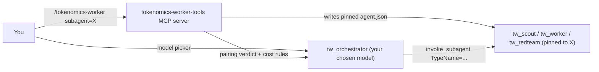

# tokenomics-worker

An orchestrator/worker plugin for the Antigravity agent IDE where **you choose
both models**. An expensive *orchestrator* keeps the judgment work
(decomposition, arbitration, review, the final answer). Cheaper, **pinned**
*subagents* do the bulk reading, typing and waiting. The plugin also checks
whether your pairing actually saves quota.

Everything is driven from chat. You don't edit config files or run scripts.

```text
/tokenomics-worker subagent=gemini-3.8-flash-high
```

## Why

Models are often billed in different units against different budgets:

| Billing | You pay for | Implication |
| :------ | :---------- | :---------- |
| **Token-metered** | Every token held in context, read, and written (output usually costs far more than a cached read) | Keep context small; never do bulk reading yourself |
| **Call-metered** | One unit per turn, however large | Batch work into fewer turns; long reads are "free" |

With a token-metered orchestrator and call-metered subagents, every file a
scout reads for you is a file you never pay to hold in context. Delegation
moves tokens from the metered budget to the unmetered one.

There are two traps:

1. `invoke_subagent` defaults to `Model: 'inherit'`. Children spawned without
   a pinned agent run on **the orchestrator's model** and bill its budget.
2. Tier names (`Model: 'flash'`) resolve to whatever the server currently puts
   in that slot. Only an `agent.json` pin selects an exact model and thinking
   level.

This plugin ships those pinned agents and lets you re-pin them to any model.
It then grades the pairing as `offload`, `partial` or `counterproductive`, so
you never run an inverted setup by accident.

## How it works



| Piece | What it is |
| :---- | :--------- |
| `tw_orchestrator` | Main agent. **Not pinned**, so it runs on whatever you pick in the model picker. Its prompt carries the subagent roster, cost rules for its billing unit, and the pairing verdict. |
| `tw_scout` | Read-only investigator: crawls, blame mining, symbol checks. Safe to fan out. |
| `tw_worker` | Implementer with a contract: mechanical test receipts, no weakened assertions, a 2-turn circuit breaker, and an `ASSIGNED_FILES_EXCLUSIVE` file boundary. |
| `tw_redteam` | Single-turn fresh-context reviewer-fixer, run on a worker's diff before you read it. |
| `tokenomics-worker` skill | Opt-in (`/tokenomics-worker`) delegation doctrine: tier routing, competing branches, worker prompt contract, anti-cheating gates, and cost rules that flip with the orchestrator's billing unit. |
| `tokenomics-worker-tools` | MCP server that does model selection, enum learning, the pairing verdict, quota/cache estimates, and test-tampering checks. |

## Requirements

- An Antigravity build that supports plugins with `agent.json` agents and
  MCP servers.
- Python 3.10+ on `PATH` as `python3`. Only the standard library is used.

## Install

```bash
git clone https://github.com/goriri/tokenomics_worker.git
# Link it into the IDE's user-level plugins folder
# (~/.gemini/config/plugins/ on the setup this was built on).
ln -sfn "$PWD/tokenomics_worker" ~/.gemini/config/plugins/tokenomics_worker
```

Restart the IDE. Agents and MCP servers are discovered at startup.

If you install it somewhere other than `~/.gemini/config/plugins/tokenomics_worker`,
set `TOKENOMICS_PLUGIN_DIR` to that path in the MCP server's environment and
run `/tokenomics-worker persist` once, so the agent prompts point at the right
`scripts/` folder.

## Quick start

A fresh install ships **unpinned** subagents. The plugin never ships or
guesses model enums (the internal IDs a pin needs), because a wrong one
silently runs the wrong model. You teach it each subagent model once.

1. **Teach it your subagent model.** Start a new conversation, select the
   model you want for subagents (for example Gemini 3.8 Flash, high thinking)
   in the model picker, and send one message. Copy that conversation's ID.
2. **Record it.** In any conversation, say:

   ```text
   learn_model gemini-3.8-flash-high from conversation <that id>, billing unit calls
   ```

   The name (`gemini-3.8-flash-high`) is yours to choose; it is what you type
   later. The tool reads the model enum from the IDE's own record of that
   conversation and saves it.
3. **Pick the orchestrator.** Open a new conversation, choose the
   `tw_orchestrator` agent and your orchestrator model (for example Claude Opus
   5.5) in the picker.
4. **Pin the subagents:**

   ```text
   /tokenomics-worker subagent=gemini-3.8-flash-high orchestrator=opus-5.5-high
   ```

   The pins load on the next turn, with no restart. `orchestrator=` only tells
   the cost check which model you picked.
5. **Make it the default** for new conversations (optional): add `persist`
   to the same command, then restart the IDE.

## Choosing models

| What | How |
| :--- | :-- |
| Orchestrator | The IDE's model picker. |
| Subagents, this conversation | `/tokenomics-worker subagent=<id>`; per role: `scout=<id> worker=<id> redteam=<id>` |
| Subagents, as defaults | Add `persist`. Saves `tokenomics.config.json` and re-renders `agents/`. Takes effect after an IDE restart. |
| Preview the verdict only | Ask for a dry run (`set_models` with `dry_run: true`). |
| Refuse bad pairings | `strict: true` refuses to install a `counterproductive` pairing. |
| What's active? | "Show my tokenomics-worker config" calls `get_model_config`. |
| Which model really answered? | `get_model_config` with a conversation ID returns `live_model`, the enum recorded for its last turn. |
| Known models | "List tokenomics-worker models" calls `list_models`. |

Session pins get distinct TypeNames (for example
`tw_worker_gemini_3_8_flash_high`) so the plugin's own `tw_worker` cannot
shadow them. They are written to the conversation's own
`<app data dir>/brain/<conversation id>/.agents/agents/` folder.

## Billing and the pairing verdict

Give each model a billing block, either when you teach it (`learn_model ...
billing unit calls`) or later by hand in `tokenomics.config.json`:

```json
"billing": {
  "unit": "tokens",
  "bucket": "my-provider-daily",
  "daily_limit": 50000000,
  "token_weights": {"cached_input_read": 0.25, "uncached_input": 2.5,
                    "cache_write": 3.125, "output_and_thinking": 12.5},
  "cache_ttl_seconds": 300
}
```

`unit` is `tokens`, `calls` or `unknown`. Only `unit` is required. With
`billing_like: "<other id>"`, a model copies another model's billing, flagged
as assumed.

| Orchestrator | Subagent | Level | Why |
| :----------- | :------- | :---- | :-- |
| tokens | calls (other bucket) | `ok` | Classic offload: a worker reading 500k tokens costs one call. |
| calls | calls (other bucket) | `ok` | Each worker turn spends the other bucket; delegate multi-turn loops. |
| tokens | tokens (other bucket) | `warn` | Moves to a second budget, but still metered. |
| any | same bucket | `warn` | No load spread, only context isolation. |
| any | unknown billing or alias | `warn` | Can't be verified. |
| calls | tokens | `risk` | Inverted: long reads become the expensive part. |
| X | X (same model) | `risk` | Same as `Model: 'inherit'`. |
| any | not pinned | `risk` | The subagent runs on whatever the IDE picks. |

The overall verdict is `offload` (all `ok`), `partial` (any `warn`) or
`counterproductive` (any `risk`). The skill also switches the orchestrator's
cost doctrine on its billing unit:
- **Token-metered orchestrators** keep the prompt cache warm and write little.
- **Call-metered ones** batch work into fewer turns and never spend a turn on
  keepalive.

## MCP tools (`tokenomics-worker-tools`)

| Tool | What it does |
| :--- | :----------- |
| `set_models` | Choose orchestrator, subagent and per-role models. Installs session pins by default. `persist` saves them as defaults, `dry_run` previews, `strict` refuses counterproductive pairings. Returns the TypeNames to use and the verdict. |
| `get_model_config` | Defaults per role (model, pinned?, enum, billing), the verdict and cost rules, session pins, and `live_model` for a conversation. |
| `list_models` | Known model IDs, labels, enums and billing, with an optional filter. |
| `learn_model` | Records a model's enum from a conversation that ran on it, plus an optional `label`, `billing` or `billing_like`. |
| `get_quota_status` | Usage estimate per bucket from the local ledger and the configured limits. |
| `get_cache_status` | Prompt-cache warmth estimate for the configured orchestrator. It says when cache state doesn't affect quota. |
| `detect_test_tampering` | Flags weakened, deleted or skipped assertions in a diff. |
| `record_orchestration_event` | Appends to the local ledger `<app data dir>/telemetry/tokenomics_events.jsonl`. Nothing leaves your machine. |

Quota and cache figures are **estimates** computed from your configured
billing. The plugin doesn't query any provider's billing backend.

## Files

| File | Purpose | Committed? |
| :--- | :------ | :--------- |
| `tokenomics.default.json` | Shipped defaults: orchestrator, subagent, role overrides | yes |
| `tokenomics.config.json` | **Your** choices and learned enums, written by `set_models persist` and `learn_model` | no (gitignored) |
| `models.json` | Optional shared labels and billing; never enums | yes |
| `templates/agents/*.json` | Agent templates. Edit these, not `agents/`. | yes |
| `agents/tw_*/agent.json` | Rendered from templates and the active config | yes (rendered from defaults) |
| `lib/tokenomics_config.py` | Config loading, model resolution, economics, enum learning | yes |
| `lib/render.py` | Agent rendering and session pins | yes |
| `mcp/tokenomics_tools_server.py` | The MCP server (stdio, stdlib only) | yes |
| `scripts/verify_and_record.py` | End-of-task gate plus `verify-citations`, `lint-readability` and `recover-transcript` modes | yes |
| `skills/tokenomics_worker/` | The skill and its references | yes |

> [!NOTE]
> After you `persist` locally, `agents/tw_*/agent.json` contain your enums and
> billing. If you develop on the plugin, don't commit those renders. Use
> `git update-index --skip-worktree agents/*/agent.json`, or re-render from
> defaults before committing (see Development).

## Verifying a pin

Pins fail silently. After a subagent's first turn, ask for `get_model_config`
with the **subagent's** conversation ID. Its `live_model` must equal the enum
listed for that role. If it doesn't, the pin didn't take; see
Troubleshooting.

## Troubleshooting

| Symptom | Fix |
| :------ | :-- |
| Agents call `scripts/verify_and_record.py` at the wrong path | Set `TOKENOMICS_PLUGIN_DIR` (see Install) and re-run `set_models persist`. |
| "cannot find the IDE app data directory" | The plugin looks for a folder under `~/.gemini/` containing `conversations/` and `brain/`. Set `TOKENOMICS_APP_DIR` in the MCP server's environment to override. |
| `learn_model`: "no recorded model_enum yet" | Send at least one message in that conversation first. |
| Verdict says a role is **not pinned** | Teach that model with `learn_model`, then run `set_models`. |
| A `tw_*` TypeName is "not found" | A malformed `agent.json` stops the agent loading. Check that you edited `templates/`, not `agents/`, and re-run `set_models persist`. A stray `agent.md` next to `agent.json` also shadows it; `set_models` deletes one when it finds it. |
| New tools or defaults don't appear | Restart the IDE. The MCP server and plugin agents load at startup. Session pins don't need a restart. |

## Limitations

- Pinning relies on IDE behaviour that isn't formally documented: the
  `disable_model_selection` and `config.cascade_config.planner_config.plan_model`
  fields in `agent.json`, and the per-turn `model_enum` record in the
  conversation database. Both may change between IDE versions. Verify pins
  after upgrading.
- Not every enum is servable. Smoke-test a new pin before relying on it.
- Billing data is whatever you enter. The verdict is only as good as that.

## Development

```bash
python3 -m unittest discover -s tests -v

# Re-render agents/ from the shipped defaults (for example before committing):
python3 -c "import sys; sys.path.insert(0, 'lib'); \
import tokenomics_config as tc, render; a = tc.load_active(tc.DEFAULT_CONFIG_PATH); \
[render.write_file(p, c) for p, c in render.planned_writes(a).items()]"
```

The test suite checks that the committed `agents/` match the active config,
that every manifest is valid JSON, the economics table above, session pin
installation, enum learning, and the MCP protocol surface.
